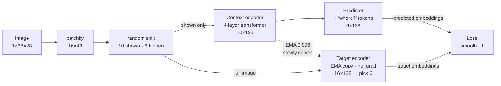
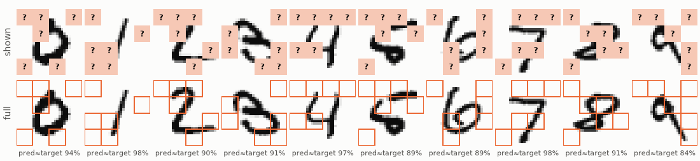
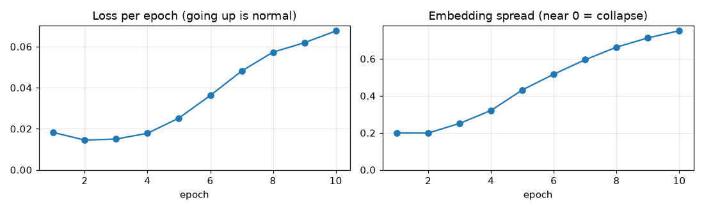
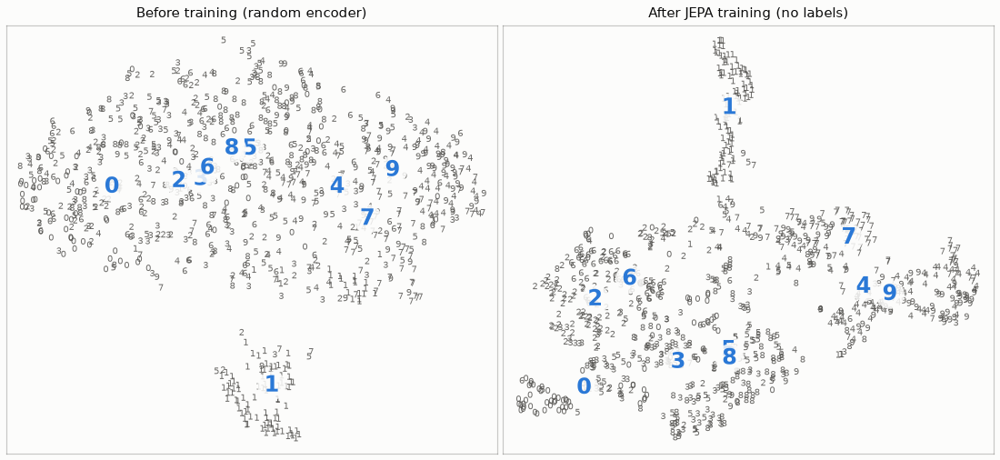

# 01 · MNIST JEPA

[](https://colab.research.google.com/github/nunenuh/jepa-playground/blob/main/01_mnist_jepa/mnist_jepa.ipynb)

The "hello world" of JEPA: a tiny I-JEPA on MNIST. No labels are used for
training. Labels are only used at the end, to measure what was learned.

## The idea

Cut each 28×28 digit into 16 patches (a 4×4 grid of 7×7). Hide 6 of them.
From the 10 visible patches, predict the **embedding** of each hidden patch,
not its pixels.

To make good predictions, the model has to work out *which digit* it is
looking at. So it ends up learning digit features without ever seeing a label.

## Architecture (one training step)



| Part | In the code | Trained how |
|---|---|---|
| Context encoder | `Encoder`, sees only the shown patches | gradient from the loss |
| Predictor | `Predictor`, gets mask tokens at the hidden positions | gradient from the loss |
| Target encoder | `copy.deepcopy(context_enc)`, sees the full image | **no gradient**: EMA of the context encoder |
| Loss | `F.smooth_l1_loss(pred, target)` | embeddings only, no decoder, no pixels |

The EMA target plus `torch.no_grad()` is what stops **collapse** (every image
getting the same embedding, which would make the loss trivially 0).

## Results

10 epochs, RTX A2000 laptop GPU, about 2 minutes.

| | Linear probe accuracy |
|---|---|
| Before training (random encoder) | 56.1% |
| After JEPA training (no labels) | **82.7%** |

The linear probe is one linear layer trained on the frozen embeddings. It can
only read what the encoder already learned.

### The task



Top row: what the context encoder sees (orange = hidden). Bottom row: the full
image the target encoder sees. The % is the cosine similarity between the
predicted and the real embedding of the hidden patches.

### Training curves



- **Loss goes up, and that's normal.** The targets come from the EMA encoder,
  which keeps learning, so the task gets harder as embeddings get richer. In
  JEPA a falling loss does not mean progress; a loss near 0 usually means
  collapse.
- **Spread** is the average standard deviation of embeddings across the batch.
  It grows from 0.20 to 0.75. If it drops towards 0, the model has collapsed.

### Why accuracy jumped



t-SNE squashes the 128-D embeddings to 2-D; each point is drawn as its digit.
Before training, groups overlap (only "1" stands apart). After training,
0, 1, 2, 6, 7 form clean groups. 4/9 and 3/5/8 still mix: they differ only by
small strokes, and that is where the missing ~17% comes from.

## Experiments to try

Change one line at a time and re-run:

| Change | What you'll see |
|---|---|
| `EMA = 0.0` | Spread falls, probe accuracy drops: collapse |
| `N_TARGET = 2` / `N_TARGET = 12` | Too easy / nothing left to predict from |
| `EPOCHS = 30` | How far probe accuracy climbs |

## Run

```bash
# from the repo root
uv run --with torch --with torchvision --with matplotlib --with scikit-learn \
    python 01_mnist_jepa/mnist_jepa.py
```

Or click the Colab badge above (everything is preinstalled there).
Edit `mnist_jepa.py`, then regenerate the notebook:
`jupytext --to ipynb 01_mnist_jepa/mnist_jepa.py`.
