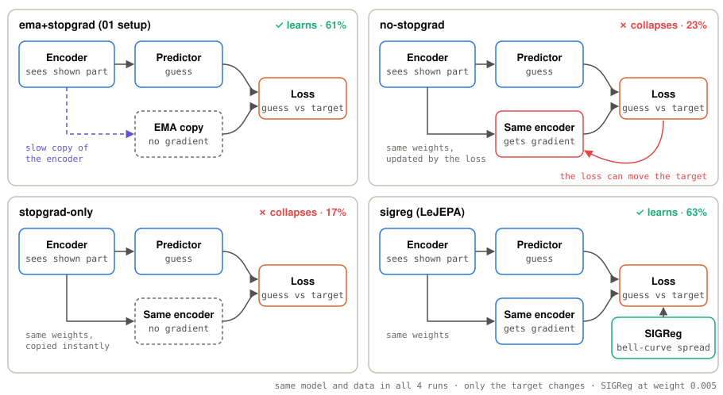
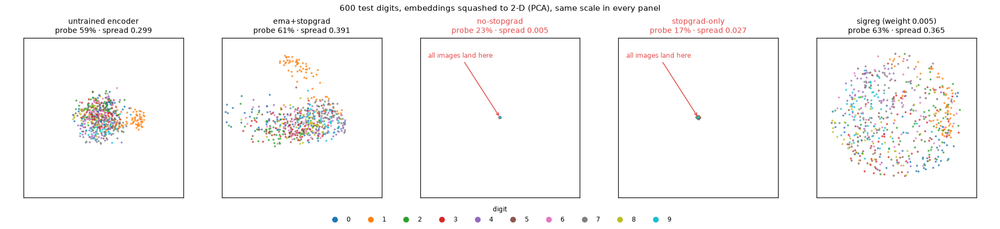

# 02 · Collapse on purpose

[](https://colab.research.google.com/github/nunenuh/jepa-playground/blob/main/02_collapse/collapse.ipynb)

JEPA has a cheat: if the encoder maps **every image to the same embedding**,
the predictor can output that constant and the loss is ~0. That is
*collapse*, and the model learns nothing.

Here the same MNIST JEPA from [experiment 01](../01_mnist_jepa/) is trained
four ways to see what stops the cheat:

| Run | Target comes from | Gradient into target? | Extra loss |
|---|---|---|---|
| `ema+stopgrad` | EMA copy of the encoder (01 setup) | no | – |
| `no-stopgrad` | the encoder itself | **yes** | – |
| `stopgrad-only` | the encoder itself, detached | no | – |
| `sigreg` | the encoder itself | **yes** | SIGReg (LeJEPA) |

<picture>
  <source media="(prefers-color-scheme: dark)" srcset="assets/variants-dark.svg">
  
</picture>

The encoder, predictor and loss are the same in all 4 runs. Only the
**target** changes: where it comes from, and whether the loss can push it.

## Setup

| Part | What it is |
|---|---|
| Model | 01's MNIST JEPA: 16 patches, 6 hidden, 128-D, small transformer encoder and predictor |
| Runs | 4 target variants (table above), same seeds, same everything else |
| SIGReg | weight 0.05 on the encoder's embeddings (LeJEPA's anti-collapse loss) |
| Training | 5 epochs per run, batch 256, AdamW (lr 1e-3), no labels |
| Collapse checks | spread (std across the batch), effective rank, linear probe |
| Hardware | Colab T4, about 70 s per run |

## Results

5 epochs per run, Colab T4, about 70 s per run.


| Run | Final loss | Spread | Linear probe |
|---|---|---|---|
| `ema+stopgrad` | 0.027 | 0.388 | **61.4%** |
| `no-stopgrad` | 0.0005 | 0.005 | 22.6% |
| `stopgrad-only` | 0.008 | 0.027 | 17.1% |
| `sigreg` (weight 0.05) | 0.475 | 0.883 | 57.8% |
| random encoder, no training | – | – | 58.7% |

Raw numbers: [`assets/results.json`](assets/results.json).

### What collapse looks like



Each dot is one test digit's embedding, squashed from 128-D to 2-D (PCA), on
the **same scale** in every panel. The two collapsed runs put all 600 digits
on (almost) one point: the encoder answers "the same" for every image.
EMA and SIGReg keep the cloud spread out. Digits don't separate cleanly in
2-D; the probe accuracy says how much digit information the full 128-D keeps.
(From a re-run on Colab with the same seeds, numbers identical; SIGReg here
uses weight 0.005. Data: [`assets/embeddings_2d.json`](assets/embeddings_2d.json).)

## What it shows

- **Collapse is real, and the loss hides it.** Without EMA the loss drops to
  almost 0 while spread falls to 0.005: every image gets nearly the same
  embedding. Probe accuracy ends up *below an untrained network*. In JEPA a
  tiny loss is a warning sign, not success.
- **Stop-gradient alone is not enough.** Detaching the target still collapses.
  What saves the 01 setup is the *slowly moving* EMA target.
- **EMA + stop-gradient works**: the only trick-based run that beats random,
  and its spread keeps growing. (5 epochs here; 01 reaches 82.7% with 10.)
- **SIGReg needs the right weight.** It never collapses, but at weight 0.05 the
  "be Gaussian" term (~0.47) swamps the prediction loss (~0.01), so the model
  learns little. A small sweep:

  | `SIGREG_WEIGHT` | Spread | Eff. rank | Linear probe |
  |---|---|---|---|
  | 0.05 | 0.883 | 32.6 | 57.8% |
  | **0.005** | 0.365 | 11.5 | **63.1%** (beats EMA) |
  | 0.001 | 0.207 | 5.4 | 48.1% (too weak, dimensions shrink) |

  So SIGReg replaces both tricks (no EMA, no stop-gradient) with one honest
  loss term, but it has one knob to tune.

- **Effective rank can mislead.** The collapsed runs score ~105: what is left
  of their embeddings is tiny random noise, which spreads evenly over all
  dimensions. Trust spread and probe accuracy first.

## Experiments to try

| Change | What you'll see |
|---|---|
| `SIGREG_WEIGHT = 0.005` | SIGReg beats EMA (see sweep above) |
| `EPOCHS = 20` | Whether SIGReg keeps its lead over EMA |
| `EMA = 0.9` / `EMA = 0.9999` | Target moves too fast (collapse risk) / too slow (learns slowly) |

## Run

Click the Colab badge above, pick a GPU runtime, then Run all. Or locally:

```bash
uv run --with torch --with torchvision --with matplotlib \
    python 02_collapse/collapse.py
```
