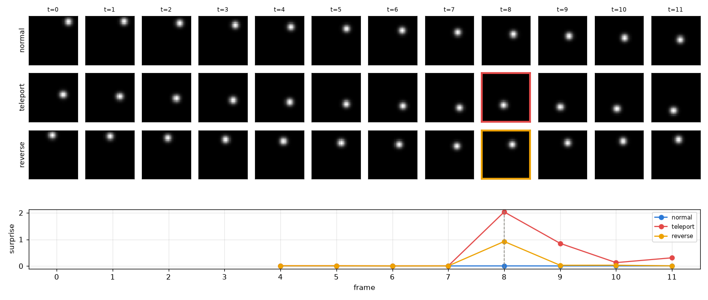
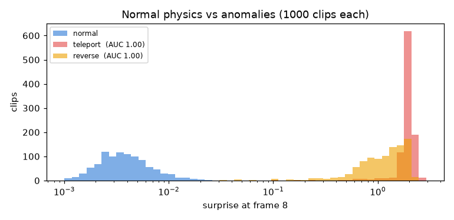
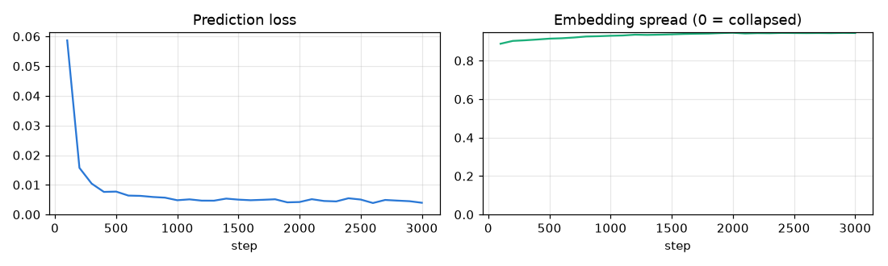

# 03 · Moving-ball world model

[](https://colab.research.google.com/github/nunenuh/jepa-playground/blob/main/03_moving_ball/moving_ball.ipynb)

Experiments 01–02 hid part of an **image**. Here we hide the **future**:
given 4 frames of a bouncing ball, predict the *embedding* of the next frame.
That is a tiny world model, the idea behind V-JEPA.

The payoff is **anomaly detection without anomaly labels**. The model only
ever sees normal physics. When something impossible happens, its prediction
is wrong: prediction error = *surprise* = anomaly score.

No dataset to download: the clips are simulated in code, fresh every step.

## Setup

| Part | What it is |
|---|---|
| World | 32×32 frames, one ball, constant speed (1–2.5 px/frame), bounces off walls |
| Encoder | small CNN, one frame → 128-D embedding |
| Predictor | MLP, 4 frame embeddings → embedding of frame 5 |
| Loss | MSE(predicted, real next-frame embedding) + 0.002 × SIGReg |
| Anomalies (test only) | **teleport**: ball jumps to a random spot; **reverse**: ball turns around mid-air |

3000 steps × 256 clips, Colab T4, about 1 minute.

## Results

| | Before training | After training |
|---|---|---|
| Teleport detection (AUC) | 0.49 | **1.00** |
| Reverse detection (AUC) | 0.49 | **1.00** (0.9996) |
| Ball position from embedding (linear R²) | 0.98 | 1.00 |

AUC = chance a random anomalous clip gets a higher surprise than a random
normal one (0.5 = guessing, 1.0 = perfect). Raw numbers:
[`assets/results.json`](assets/results.json).

### One clip of each kind



Surprise is flat while the physics is normal, then spikes exactly at frame 8
when the anomaly happens. After a teleport it stays raised for a frame or two:
the 4-frame context now contains the jump, so the next prediction is also off
until the context is clean again.

### 1000 clips of each kind



Median surprise at frame 8: normal 0.004, reverse 1.23, teleport 1.94, a gap
of more than 300×. Note the log scale.

### Training



Spread stays near 0.94: the embeddings never collapse.

## What it shows

- **A world model is just "predict the next embedding".** Same recipe as
  01, with the hidden part moved from space to time.
- **Surprise is a free anomaly detector.** No anomaly was ever shown in
  training, yet both kinds are separated almost perfectly.
- **The model learned velocity, not just position.** "Reverse" puts the ball
  at a position it *was* at a moment ago, a perfectly normal-looking frame.
  It is only surprising if you know which way the ball was moving.
- **Anti-collapse matters again (lesson from 02).** The first version used
  the EMA target from 01 and collapsed (spread 0.005): with a single dot on
  a black frame, it's too easy to make every frame look alike. It still
  caught teleports (AUC 0.71) but not reversals (0.44). Swapping in SIGReg
  fixed it; every weight from 0.0005 to 0.05 gave AUC ≥ 0.997.
- **Linear position R² is not a good test here.** Even a random CNN gets 0.98,
  because where the bright pixels are survives random filters. The surprise
  AUC is the real measure of what was learned.

## This is experiment 04 in miniature

| Here | Agent guardrail (04) |
|---|---|
| a frame | one agent step (tool name + arguments + result) |
| 4 past frames | the last few steps of the trajectory |
| normal physics | normal agent behaviour |
| teleport / reverse | prompt injection, data exfiltration, a tool call that doesn't fit |
| surprise spike | flag or block that step |

## Experiments to try

| Change | What you'll see |
|---|---|
| `CTX = 2` | Can velocity still be inferred? (it needs 2 frames) |
| Add a subtler anomaly: speed suddenly ×1.5 | How small a change surprise can catch |
| Two balls that bounce off each other | Harder physics, does AUC hold? |

## Run

Click the Colab badge above, pick a GPU runtime, then Run all. Or locally:

```bash
uv run --with torch --with matplotlib python 03_moving_ball/moving_ball.py
```
