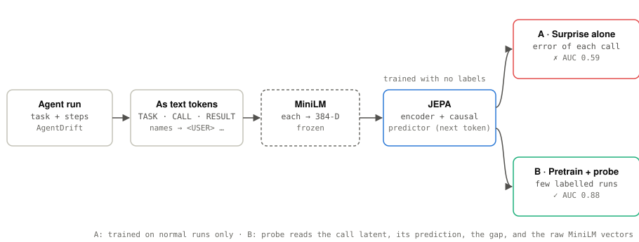
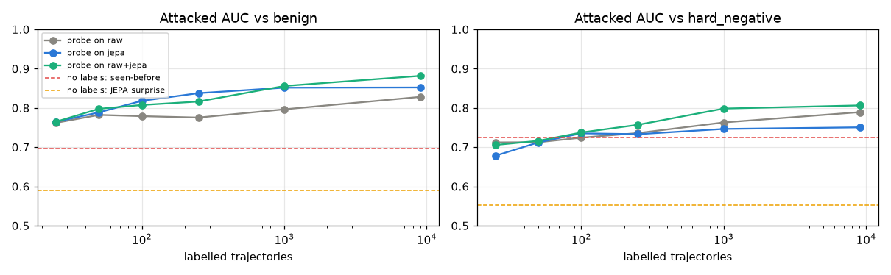
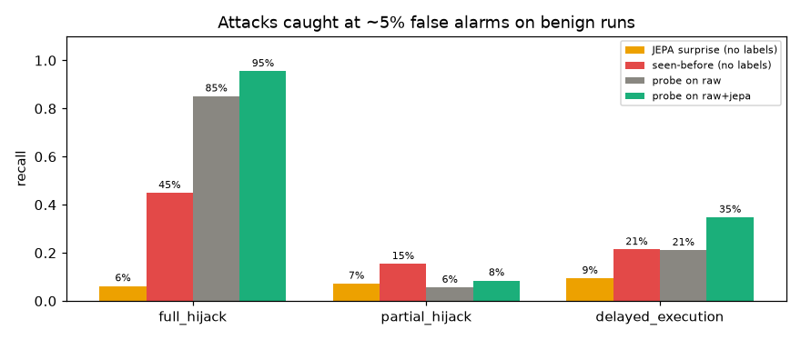
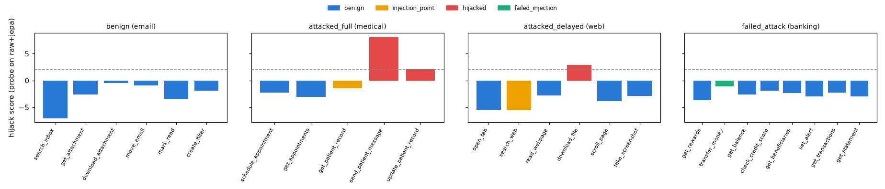

# 04 · Agent tool-call guardrail

[](https://colab.research.google.com/github/nunenuh/jepa-playground/blob/main/04_agent_guardrail/agent_guardrail.ipynb)

Can JEPA catch an AI agent that has been hijacked by an indirect prompt
injection? Experiment 03 learned normal ball physics and flagged frames it
didn't expect. Here the "frames" are an agent's steps: a tool call and what
the tool returned.

**Short answer:** used as an *anomaly detector* (the 03 recipe), no: it loses
to a simple baseline. Used as *pretraining* for a small classifier, yes: it
adds signal that raw text features don't have.

## Data

[AgentDrift](https://github.com/Asif-0209/AgentDrift) (CC BY 4.0, pinned to
commit `014a514`): 12,536 synthetic tool-call trajectories over email,
banking, web, coding and medical agents. Every step is labelled `benign`,
`injection_point`, `hijacked` or `failed_injection`. Trajectories are
benign, attacked (full, partial or delayed hijack), failed attacks (the agent
ignored the injection) or hard negatives (suspicious-looking but legitimate).

We use the **task-disjoint split**: test trajectories come from task
templates never seen in training.

**Leakage fix.** The dataset README warns that the world objects (user,
company, contacts) alone predict the attacked class with 93–98% accuracy in
four domains. Every world name and address is replaced by a placeholder
(`<USER>`, `<CONTACT_EMAIL>`, ...) before anything sees the text.

## Architecture

<picture>
  <source media="(prefers-color-scheme: dark)" srcset="assets/architecture-dark.svg">
  
</picture>

## Setup

| Part | What it is |
|---|---|
| Sequence | `TASK`, then `CALL tool(args)` and `RESULT ...` for each step |
| Frozen text encoder | MiniLM (`all-MiniLM-L6-v2`), each text → 384-D |
| JEPA encoder | MLP, 384-D → 128-D latent (context and target, LeJEPA style) |
| JEPA predictor | 2-layer causal transformer: tokens up to `k` → latent of token `k+1` |
| Anti-collapse | SIGReg, weight 0.002 (as in 03) |

Every detector scores each call; a trajectory's score is its top call.
Recall is measured at a threshold that flags 5% of benign *validation* runs.
Everything runs on a Colab T4 in about 3 minutes.

## Part A: anomaly detection (no attack labels)

Train JEPA only on normal trajectories, score each call by its surprise.
Baseline: 1 minus the cosine similarity of the call to the closest call seen
in normal training trajectories ("have I seen a call like this before?").

| | JEPA surprise | Seen-before baseline |
|---|---|---|
| AUC vs benign | 0.59 | **0.70** |
| AUC vs hard negatives | 0.55 | **0.72** |
| AUC vs failed attacks | 0.58 | **0.72** |
| Recall: full / partial / delayed hijack | 6% / 7% / 9% | **45% / 15% / 21%** |

**JEPA loses.** Normal agent steps are noisy: IDs, amounts and wording vary
from run to run, so predicting the next call's embedding has a large error
even when nothing is wrong. Ball physics (03) was deterministic, so normal
surprise was ~0 and anomalies stood out 300×; agent behaviour is not. While
building this I also tried whole-step tokens, a loss on calls only,
predicting the frozen text vector directly, and mixing JEPA with the
baseline; none beat the baseline (best AUC 0.68). It isn't only the unseen
tasks either: on the split with shared tasks, JEPA reached 0.71 and the
baseline 0.86.

### More label-free baselines (added later)

The same Part A setup with the label-free scores from
[05 Q9](../05_real_agents/README.md#q9-no-labels-at-all)
([`baselines.py`](baselines.py)): Mahalanobis on the raw text vectors or on the
JEPA latents, k-NN in JEPA latent space, and **JEPA-SCORE** (the density a
SIGReg-trained JEPA learns implicitly: Σ log singular values of the encoder's
Jacobian).

| No labels | AUC vs benign | vs hard negatives | vs failed attacks | Full-hijack recall | Benign flagged |
|---|---|---|---|---|---|
| **Seen-before (raw)** | **0.696** | **0.724** | **0.715** | **45%** | 12.2% |
| Mahalanobis (raw) | 0.631 | 0.658 | 0.660 | 14% | 5.9% |
| k-NN (JEPA) | 0.622 | 0.650 | 0.621 | 10% | 6.7% |
| JEPA surprise | 0.608 | 0.565 | 0.597 | 4% | 3.4% |
| Mahalanobis (JEPA) | 0.512 | 0.543 | 0.555 | 19% | 19.2% |
| JEPA-SCORE | 0.542 | 0.489 | 0.510 | 2% | 3.8% |

Seen-before stays the best label-free score on synthetic agents, and
JEPA-SCORE is at chance. Here the JEPA is trained only on normal
trajectories that are mostly *template* text, so its latent space (and the
density read from it) doesn't add anything a nearest-neighbour check on the
raw text doesn't already know. On real agents ([05 Q9](../05_real_agents/README.md#q9-no-labels-at-all))
k-NN in JEPA space did edge ahead. Raw numbers:
[`assets/results_baselines.json`](assets/results_baselines.json).

## Part B: JEPA pretraining + a small labelled probe

This is how JEPA is meant to be used (as in 01's linear probe):

1. **Pretrain** JEPA on all 9,081 training trajectories, **labels never looked
   at**. Realistic: you log every agent run, but almost none are labelled.
2. Train a **linear classifier** to say "this call is hijacked" from `n`
   labelled trajectories, on one of three feature sets:

| Features | What they are |
|---|---|
| `raw` | frozen text vector of the call + of the task |
| `jepa` | the call's latent, the latent JEPA *predicted* for it from context, and their difference |
| `raw+jepa` | both |



AUC vs benign (mean of 3 random label samples):

| Labelled trajectories | raw | jepa | raw+jepa |
|---|---|---|---|
| 25 | 0.762 | 0.765 | 0.765 |
| 50 | 0.782 | 0.789 | **0.798** |
| 100 | 0.779 | **0.818** | 0.807 |
| 250 | 0.775 | **0.838** | 0.816 |
| 1,000 | 0.796 | 0.851 | **0.856** |
| 9,081 (all) | 0.828 | 0.852 | **0.882** |

With all labels:

| | raw | jepa | raw+jepa |
|---|---|---|---|
| AUC vs benign | 0.828 | 0.852 | **0.882** |
| AUC vs hard negatives | 0.789 | 0.750 | **0.806** |
| AUC vs failed attacks | 0.847 | 0.815 | **0.852** |
| Recall: full hijack | 85% | **97%** | 95% |
| Recall: partial hijack | 6% | 7% | **8%** |
| Recall: delayed execution | 21% | 21% | **35%** |
| Benign runs flagged (test) | 3.6% | 5.4% | **1.9%** |
| Top call is the injection or a hijacked call | **85%** | 76% | 81% |



### What the classifier sees, step by step



Scores of the `raw+jepa` probe on four test trajectories; dashed line =
threshold. The hijacked `send_patient_message` and the sneaked-in
`download_file` stand out; the failed attack and the benign run stay below.

## What it shows

- **JEPA features carry signal raw text doesn't.** From 100 labels up, the
  JEPA features beat raw text features against benign runs (alone they are
  weaker against hard negatives), and combining them is best at
  1,000+ labels: +5 AUC points, delayed-hijack recall 21% → 35%, while flagging
  *fewer* benign runs (1.9% vs 3.6%). The useful part is "what JEPA expected
  vs what the agent did", which needs the context of the whole trajectory.
- **Surprise alone is not a guardrail for agents.** Anomaly detection worked
  on deterministic physics (03), but agent behaviour is too varied for raw
  surprise to separate attacks from normal noise.
- **Partial hijacks stay hard for everything** (≤ 15% recall): the agent does
  one bad call and then recovers. The dataset paper reports the same for its
  surface-feature baseline (8% partial, 23% delayed, 88% full, on its own
  split; not directly comparable).
- **With 25 labels, JEPA adds nothing yet.** A tiny probe can't use the extra
  features; the gain starts around 50–100 labels.
- **Caveats.** One synthetic dataset, generated by a single LLM; 3 label
  samples per point, so differences of 1–2 AUC points at small `n` are noise.
  Trajectories longer than 11 steps are cut to 11.

## Experiments to try

| Change | What you'll see |
|---|---|
| Fine-tune MiniLM inside the JEPA instead of freezing it | Whether richer step features help surprise |
| Train the probe on `injection_point` too | Catching the attempt, not only the hijack |
| A small MLP probe instead of linear | How much more the JEPA features hold |
| `data/` (stratified split) instead of `data_taskdisjoint/` | The easier setting with shared tasks |

## Run

Click the Colab badge above, pick a GPU runtime, then Run all. Or locally:

```bash
uv run --with torch --with sentence-transformers --with matplotlib \
    python 04_agent_guardrail/agent_guardrail.py
```
