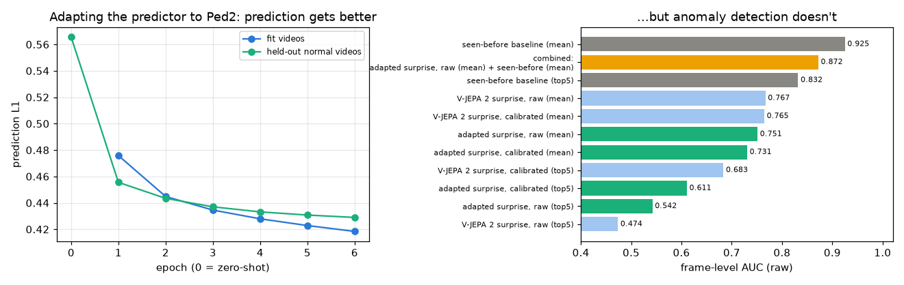

# 06 · V-JEPA 2 on real video: zero-shot anomaly detection

[](https://colab.research.google.com/github/nunenuh/jepa-playground/blob/main/06_vjepa2_video/vjepa2_anomaly.ipynb)

Experiment 03 trained a tiny world model on a bouncing ball and used its
**prediction error** ("surprise") to spot teleports and reversals. Does the
same idea work on **real surveillance video** using a pretrained foundation
world model (**Meta's V-JEPA 2**, 300M parameters) with **zero training on the
target dataset**?

## Architecture

<picture>
  <source media="(prefers-color-scheme: dark)" srcset="assets/architecture-dark.svg">
  
</picture>

## Data

[UCSD Ped2](http://www.svcl.ucsd.edu/projects/anomaly/dataset.htm): a fixed
overhead camera watching a campus walkway.
- **16 training videos**: normal walking pedestrians only.
- **12 test videos** (2,010 frames total; 1,648 anomalous frames): bicycles,
  skateboards, and maintenance carts moving through the crowd.


Each 16-frame clip is resized to `256 × 256` (full frame, no crop, so edge
anomalies are never cut off). V-JEPA 2's encoder turns every `2 × 16 × 16`
tubelet into a `1024-D` latent (`8 × 16 × 16` grid). We give the predictor the
first **12 frames** (`6 × 16 × 16` latents) and ask it to predict the last
**4 frames** (`2 × 16 × 16` latents).

## Setup

| Part | What it is |
|---|---|
| Backbone | `facebook/vjepa2-vitl-fpc64-256` (ViT-L encoder + predictor, frozen, `fp16`; Part 2 fine-tunes the predictor) |
| Sliding window | 12 past frames → predict 4 future frames, stride 2 frames |
| Frame score | Mean of the **top-5 most surprising patches** in the `16 × 16` spatial grid (anomalies cover only a few patches; whole-frame mean washes them out on calibrated maps) |
| **V-JEPA 2 surprise, raw** | Raw L1 distance between predicted and layer-normed target latents |
| **V-JEPA 2 surprise, calibrated** | Per-patch z-score `(s − μ) / σ` using the mean `μ` and std `σ` of each spatial cell across the 16 normal training videos |
| **Seen-before baseline** | No predictor: cosine distance to the closest normal training latent at the **same spatial position** (588 training tubelets) |

Hardware: Colab Tesla T4 (16 GB VRAM). Memory bank + calibration stats: **78 s**;
scoring all 12 test videos: **246 s** (~5.5 min for Part 1; Part 2 adds ~10 min).

## Results

| Method | AUC raw | AUC per-video normalised | AUC raw, whole-frame mean |
|---|---:|---:|---:|
| V-JEPA 2 surprise, raw | 0.474 | 0.481 | 0.767 |
| **V-JEPA 2 surprise, calibrated** | **0.683** | **0.668** | 0.765 |
| **Seen-before baseline (encoder only)** | **0.832** | **0.789** | **0.925** |


### Why raw top-5 surprise fails (and calibration helps)

Taking the top-5 raw surprise patches scored below chance (**0.474 AUC**),
although averaging the whole frame gave **0.767**. Some positions are hard to
predict even on normal video (the usual-surprise map μ is highest along the
grass/hedge strip and some pavement edges), and the top-5 often land there:
**33%** of the raw top-5 patches fall on the 20 positions (8% of the frame)
that are noisiest on normal video, 4× more than chance.

Normalising each `16 × 16` cell by its usual surprise, `(s − μ) / σ` on
normal training video, removes that: only **3%** of the calibrated top-5
patches land there, and top-5 AUC rises from **0.474 → 0.683**. The noisy
positions explain part of the failure, not all of it: calibrated surprise is
still far below seen-before.


Frame 72 of test video `04`, where a cart drives in. Left to right: the
usual surprise μ, raw surprise, calibrated surprise and the seen-before
distance. Seen-before marks the cart clearly; calibrated surprise is high
next to and below it, but also at scattered pavement spots.

### Where V-JEPA 2 is surprised


Calibrated surprise on the least surprising normal frame and the most
surprising anomalous frame of video `04` (both taken from the middle of the
video, where every frame was really predicted). On the anomalous frame the
strongest response is around the cart's lower edge and on the pavement in
front of it; there are also weaker spots on people walking normally.

### Score over time


Video `04`: the cart enters at frame 31 and stays until the end. Seen-before
rises as it enters and stays high. Calibrated surprise also rises, then
swings up and down for the rest of the video: it reacts to the cart's
motion moment by moment, not to its presence.

## Part 2: adapt the predictor to this camera

Can we make surprise work by teaching V-JEPA 2 what *normal* looks like on
this camera? We fine-tune **only the predictor** (22M parameters; the 300M
encoder stays frozen) on Ped2's normal training videos: 12 videos for
fitting, 4 held out for early stopping and for calibrating the surprise.
6 epochs, ~4 minutes on the T4.



| Score (frame-level AUC, raw) | Zero-shot | Adapted predictor |
|---|---|---|
| Surprise, whole-frame mean | **0.767** | 0.751 |
| Surprise, calibrated top-5 | **0.683** | 0.611 |
| Surprise, raw top-5 | 0.474 | 0.542 |
| Adapted surprise + seen-before (rank sum) | – | 0.872 |
| *Seen-before baseline, whole-frame mean* | ***0.925*** | |

**The predictor learns the camera, but anomaly detection doesn't improve.**
Held-out prediction error falls from 0.566 to 0.429 (−24%). Yet every
surprise score stays at 0.54–0.75, and adding surprise to the seen-before
score makes it *worse* (0.872 < 0.925). A better world model predicts the
whole scene better, bikes included: a bike riding along the walkway is
normal physics, so it isn't surprising. Ped2's anomalies are *unusual
objects*, not *impossible motion*. Raw numbers:
[`assets/results_part2.json`](assets/results_part2.json).

## What it shows

- **Real video needs calibrated surprise.** Unlike the black background of the
  ball in 03, some spots of a real scene are hard to predict even when nothing
  happens. A third of the raw top-5 patches land on those spots; calibrating
  each position against normal video fixes that part (`0.474` → `0.683` AUC).
- **Ped2's anomalies are unusual objects, not impossible motion.** A bike or a
  cart moving along the walkway is normal physics; it is an anomaly only by
  the scene's rule (no vehicles on the footpath). Our explanation for why
  surprise stays weak: a general video world model has no reason to find
  that motion unexpected. [Experiment 07](../07_physical_anomalies/) tests it
  from the other side: on the same camera, surprise catches physically
  impossible motion almost perfectly.
- **Therefore, "have I seen this patch here before?" beats pure dynamics surprise
  (`0.832` vs `0.683` top-5 AUC, `0.925` whole-frame AUC).** Just like in
  Experiments 04 and 05, frozen V-JEPA 2 representations + a simple normal
  reference bank are a remarkably strong zero-shot detector.
- **Adapting the predictor doesn't change that (Part 2).** It predicts this
  camera 24% better, but surprise still doesn't catch bikes, and combining it
  with seen-before hurts. Surprise answers "is this physically unexpected?";
  Ped2 asks "is this an unusual object here?". Pick the signal that matches
  the kind of anomaly, the same lesson as 03 vs 04.

## Experiments to try

- **A dataset whose anomalies are physical** (falls, objects thrown, sudden
  running, e.g. the CUHK Avenue "throwing" clips): where surprise should beat
  seen-before.
- **Longer prediction horizon**: predict 8 frames ahead (`T_CTX=8, T_PRED=8`) so
  fast anomalies diverge further from linear pedestrian motion.

## Run

[](https://colab.research.google.com/github/nunenuh/jepa-playground/blob/main/06_vjepa2_video/vjepa2_anomaly.ipynb)

```bash
uv run --with torch --with transformers --with scipy --with pillow --with matplotlib \
    python 06_vjepa2_video/vjepa2_anomaly.py
```
