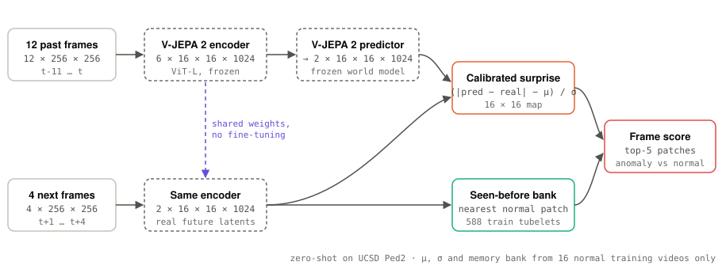
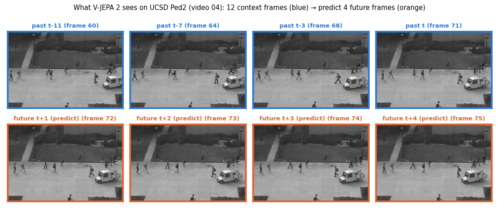
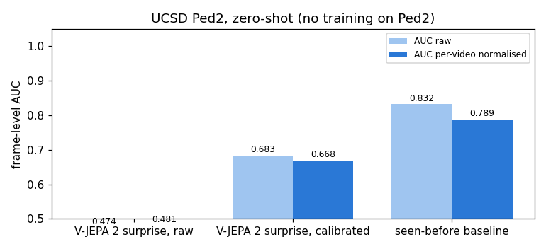
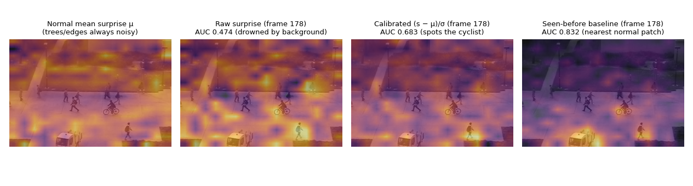
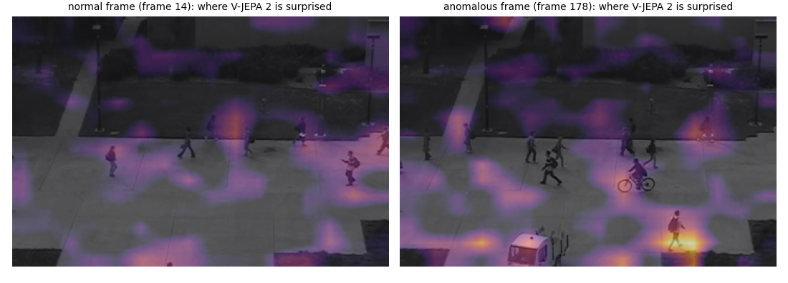
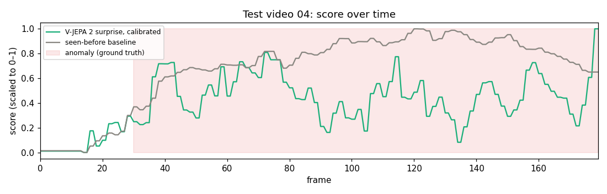

# 06 · V-JEPA 2 on real video: zero-shot anomaly detection

[](https://colab.research.google.com/github/nunenuh/jepa-playground/blob/main/06_vjepa2_video/vjepa2_anomaly.ipynb)

Experiment 03 trained a tiny world model on a bouncing ball and used its
**prediction error** ("surprise") to spot teleports and reversals. Does the
same idea work on **real surveillance video** using a pretrained foundation
world model (**Meta's V-JEPA 2**, 300M parameters) with **zero training on the
target dataset**?

## Architecture

<picture>
  <source media="(prefers-color-scheme: dark)" srcset="assets/architecture-dark.svg">
  
</picture>

## Data

[UCSD Ped2](http://www.svcl.ucsd.edu/projects/anomaly/dataset.htm): a fixed
overhead camera watching a campus walkway.
- **16 training videos**: normal walking pedestrians only.
- **12 test videos** (2,010 frames total; 1,648 anomalous frames): bicycles,
  skateboards, and maintenance carts moving through the crowd.



Each 16-frame clip is resized to `256 × 256` (full frame, no crop, so edge
anomalies are never cut off). V-JEPA 2's encoder turns every `2 × 16 × 16`
tubelet into a `1024-D` latent (`8 × 16 × 16` grid). We give the predictor the
first **12 frames** (`6 × 16 × 16` latents) and ask it to predict the last
**4 frames** (`2 × 16 × 16` latents).

## Setup

| Part | What it is |
|---|---|
| Backbone | `facebook/vjepa2-vitl-fpc64-256` (ViT-L encoder + predictor, frozen, `fp16`) |
| Sliding window | 12 past frames → predict 4 future frames, stride 2 frames |
| Frame score | Mean of the **top-5 most surprising patches** in the `16 × 16` spatial grid (anomalies cover only a few patches; whole-frame mean washes them out on calibrated maps) |
| **V-JEPA 2 surprise, raw** | Raw L1 distance between predicted and layer-normed target latents |
| **V-JEPA 2 surprise, calibrated** | Per-patch z-score `(s − μ) / σ` using the mean `μ` and std `σ` of each spatial cell across the 16 normal training videos |
| **Seen-before baseline** | No predictor: cosine distance to the closest normal training latent at the **same spatial position** (588 training tubelets) |

Hardware: Colab Tesla T4 (16 GB VRAM). Memory bank + calibration stats: **78 s**;
scoring all 12 test videos: **246 s** (~5.5 min total).

## Results

| Method | AUC raw | AUC per-video normalised | AUC raw, whole-frame mean |
|---|---:|---:|---:|
| V-JEPA 2 surprise, raw | 0.474 | 0.481 | 0.767 |
| **V-JEPA 2 surprise, calibrated** | **0.683** | **0.668** | 0.765 |
| **Seen-before baseline (encoder only)** | **0.832** | **0.789** | **0.925** |



### Why raw top-5 surprise fails (and calibration fixes it)

At first, taking the top-5 raw surprise patches scored near chance (**0.474 AUC**),
even though averaging the whole frame gave **0.767 AUC**. Why? In a static camera
scene, flickering tree leaves and walkway borders are *always* harder to predict
than flat pavement—so the top-5 patches in every frame were just the trees,
drowning out the bicycle.

Normalising each `16 × 16` cell by its usual surprise `(s − μ) / σ` on normal
training video silences the background clutter and jumps top-5 AUC from
**0.474 → 0.683**:



### Where V-JEPA 2 is surprised

On test video `04`, calibrated V-JEPA 2 surprise lights up directly on the
speeding cyclist while staying dark on normal walking pedestrians:



### Score over time

Both calibrated predictor surprise and the seen-before memory bank rise sharply
when the anomaly enters the frame and drop back down once it leaves:



## What it shows

- **Spatial calibration is essential for world-model surprise on real cameras.**
  Unlike the synthetic black-background ball in Experiment 03, real video has
  textured background patches with permanently high prediction error. Taking
  top-*k* patches without per-position `(μ, σ)` calibration picks background
  foliage instead of the anomaly (`0.474` → `0.683` AUC).
- **A fast cyclist is predictable to a general video world model.** V-JEPA 2 was
  pretrained on internet videos that include bicycles and cars! Once a bike is in
  motion, V-JEPA 2's predictor actually predicts its next 4 frames reasonably
  well—whereas in Ped2, a bike is an anomaly *by scene rule* (no bikes on the
  footpath), not because it violates physics.
- **Therefore, "have I seen this patch here before?" beats pure dynamics surprise
  (`0.832` vs `0.683` top-5 AUC, `0.925` whole-frame AUC).** Just like in
  Experiments 04 and 05, frozen V-JEPA 2 representations + a simple normal
  reference bank are a remarkably strong zero-shot detector.

## Experiments to try

- **Combine both signals**: `calibrated_surprise + α * seen_before_distance` to
  catch both unfamiliar appearance (bikes) and sudden motion changes (falls/runs).
- **Longer prediction horizon**: predict 8 frames ahead (`T_CTX=8, T_PRED=8`) so
  fast anomalies diverge further from linear pedestrian motion.
- **Fine-tune a tiny adapter on the 16 normal videos**: train a lightweight
  predictor head specifically on Ped2 normal walking so bicycles become
  genuinely unpredicted.

## Run

[](https://colab.research.google.com/github/nunenuh/jepa-playground/blob/main/06_vjepa2_video/vjepa2_anomaly.ipynb)

```bash
uv run --with torch --with transformers --with scipy --with pillow --with matplotlib \
    python 06_vjepa2_video/vjepa2_anomaly.py
```
