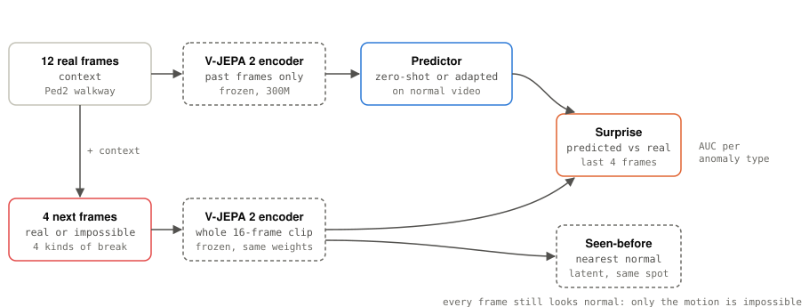
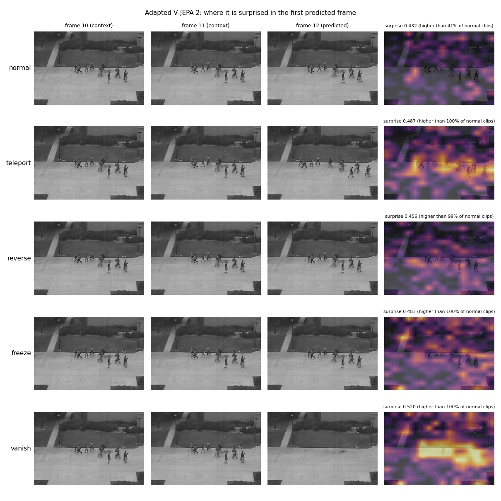
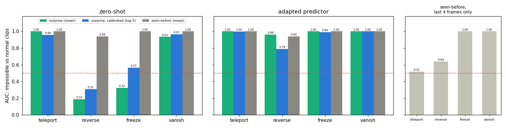
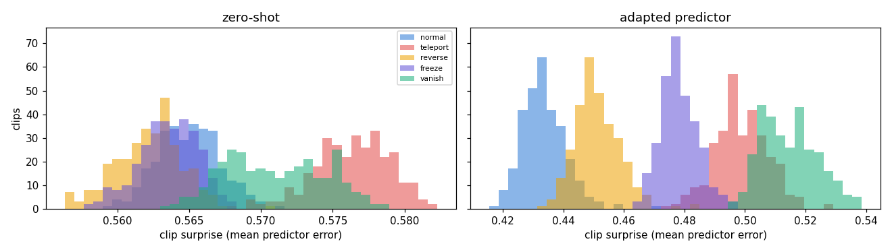

# 07 · V-JEPA 2 and physically impossible video

[](https://colab.research.google.com/github/nunenuh/jepa-playground/blob/main/07_physical_anomalies/physical_anomalies.ipynb)

In [06](../06_vjepa2_video/), V-JEPA 2's surprise lost to a simple "have I
seen this before?" check on UCSD Ped2. Our explanation: Ped2's anomalies (a
bike, a cart) are **unusual objects doing normal physics**, so a good world
model isn't surprised by them.

This experiment tests the other half of that claim: anomalies that are
**physically impossible while every single frame looks normal**. If the
world-model story is right, surprise should work here.

## Architecture

<picture>
  <source media="(prefers-color-scheme: dark)" srcset="assets/architecture-dark.svg">
  
</picture>

## Data: impossible clips made from real video

Real Ped2 walkway video (normal training videos only). From each 16-frame
clip we keep the first 12 frames and change the last 4:

| Anomaly | The last 4 frames | Physically |
|---|---|---|
| **teleport** | jump 24 frames (2.4 s) ahead | everyone is suddenly elsewhere |
| **reverse** | frames 11, 10, 9, 8 | time runs backwards |
| **freeze** | frame 11, four times | everything stops dead at once |
| **vanish** | the empty background (video median) | all people disappear |

8 videos are the **reference** (normal statistics, the seen-before memory
bank, and the data to adapt the predictor), the other 8 give the **test
clips**: 304 normal clips, each with 4 impossible copies (1,520 clips).



One test clip and its 4 impossible copies. Right: where the adapted V-JEPA 2
is surprised in the first predicted frame. Teleport lights up where people
jumped to, vanish where the people used to be.

## Setup

| Part | What it is |
|---|---|
| Model | `facebook/vjepa2-vitl-fpc64-256` (ViT-L encoder, frozen) + its predictor |
| Surprise | predict the latents of the last 4 frames from the first 12, L1 error vs the real latents |
| Calibrated surprise | per-position z-score against normal reference clips, mean of the top-5 patches (as in 06) |
| Seen-before | distance to the closest normal reference latent at the same position (as in 06) |
| Adapted predictor | only the predictor (22M) fine-tuned on the 8 reference videos, 6 epochs |
| Metric | AUC, each impossible type vs the normal clips |

Colab T4, about 17 minutes in total.

## Results



| AUC | teleport | reverse | freeze | vanish |
|---|---|---|---|---|
| Surprise, zero-shot | 0.999 | **0.189** | **0.324** | 0.934 |
| Surprise, calibrated, zero-shot | 0.957 | 0.309 | 0.566 | 0.966 |
| **Surprise, adapted predictor** | **1.000** | **0.962** | **1.000** | **1.000** |
| Surprise, calibrated, adapted | 0.997 | 0.790 | 0.992 | 1.000 |
| Seen-before (encoder sees the whole clip) | 1.000 | 0.941 | 1.000 | 1.000 |
| Seen-before, encoder sees only the last 4 frames | 0.517 | 0.639 | 1.000 | 1.000 |

Raw numbers: [`assets/results.json`](assets/results.json); every clip's
scores: [`assets/clip_scores.json`](assets/clip_scores.json). Predictor
training isn't seeded, so the adapted numbers move by about ±0.03 between
runs (a first run gave reverse 0.956, calibrated reverse 0.823).

### Clip scores



Zero-shot (left), the clip types overlap, and reversed and frozen clips are
even *less* surprising than normal ones. After adapting (right), normal clips
form their own group and every impossible type sits to the right of it.

## What it shows

- **Zero-shot surprise catches some impossible motion, not all.** Teleport
  (0.999) and vanish (0.93) are caught. Reverse (0.19) and freeze (0.32) score
  *below chance*: a frozen or slow-backwards future is *easier* to predict
  than real walking, so the predictor's error goes down, not up.
- **Adapting the predictor to the camera fixes that.** Trained only on normal
  walkway video, its surprise catches every type (0.96–1.00): it now knows
  that people *here* keep walking forward. In 06 the same adaptation made
  prediction better but didn't help with bikes; here it does, because these
  anomalies break the *dynamics*, not the *appearance*.
- **V-JEPA 2's encoder already sees motion.** Seen-before catches everything
  too, but only because the encoder looks at the whole 16-frame clip: when
  it sees only the last 4 frames, teleport (0.52) and reverse (0.64) become
  invisible. Freeze and vanish stay easy (1.00): a frozen or empty walkway
  *looks* unusual even in 4 frames.
- **Together with 06: pick the signal to match the anomaly.** Unusual objects
  doing normal things → seen-before. Normal-looking scenes doing impossible
  things → the world model's surprise, after adapting it to the scene. The
  same lesson as 03 (ball physics) vs 04 (agents).
- **Caveat.** These anomalies are synthetic edits of real video, cut in at a
  known frame; real-world physical anomalies (falls, thrown objects) are
  messier. One camera, one dataset.

## Experiments to try

| Change | What you'll see |
|---|---|
| `JUMP = 4` (small teleport) | How small a jump surprise can still catch |
| Reverse at half speed, or slow down instead of freeze | Subtler dynamics breaks |
| Edit only one person (cut-and-paste a patch) | Local anomalies instead of whole-scene ones |
| A real physical-anomaly dataset (e.g. falls) | Whether the adapted surprise holds outside synthetic edits |

## Run

Click the Colab badge above, pick a GPU runtime, then Run all. Or locally
(needs a GPU with ~12 GB):

```bash
uv run --with torch --with transformers --with matplotlib --with pillow \
    python 07_physical_anomalies/physical_anomalies.py
```
