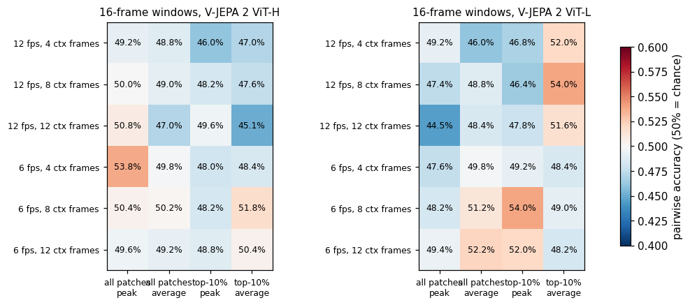
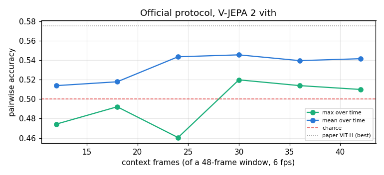
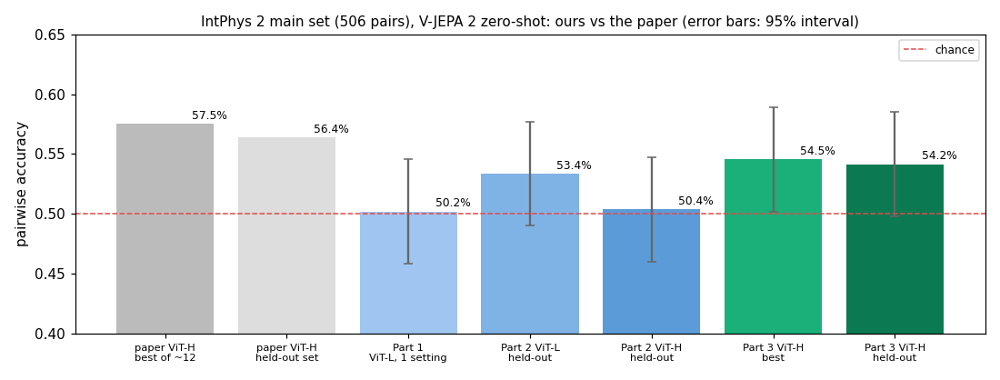

# 08 · V-JEPA 2 on IntPhys 2

[](https://colab.research.google.com/github/nunenuh/jepa-playground/blob/main/08_intphys2/intphys2.ipynb)

In [07](../07_physical_anomalies/), V-JEPA 2's surprise caught physically
impossible motion that we made by editing walkway video, once its predictor
was adapted to the camera. Does that hold on a real intuitive-physics
benchmark? **[IntPhys 2](https://huggingface.co/datasets/facebook/IntPhys2)**
(Meta, 2025) shows matched pairs of rendered videos, identical except that in
one of them physics breaks.

**Short answer: no.** With one fixed setting V-JEPA 2 (ViT-L) is at chance
(Part 1). Following the IntPhys 2 authors' own evaluation protocol, ViT-huge
reaches **54.5%** (held-out 54.2%), within noise of the paper's 57.5%, and
still far from humans (~96%) (Parts 2–3).

## Architecture

<picture>
  <source media="(prefers-color-scheme: dark)" srcset="assets/architecture-dark.svg">
  
</picture>

## Data

IntPhys 2 main set (CC BY-NC 4.0, evaluation use only), pinned to revision
`a077a2f`: 253 scenes, 1,012 videos, 506 matched pairs.

| Condition | What breaks in the impossible video | Pairs |
|---|---|---|
| permanence | an object vanishes or appears from nothing | 120 |
| immutability | an object changes shape or colour | 120 |
| continuity | an object teleports instead of moving through space | 120 |
| solidity | an object passes through another solid object | 146 |

Scenes range from simple coloured shapes (Easy) to realistic objects in
complex environments (Hard), with fixed or moving cameras.

## Setup

| Part | What it is |
|---|---|
| Model | `facebook/vjepa2-vitl-fpc64-256` (ViT-L encoder frozen) + its predictor |
| Video | every 10th frame (6 fps, as in the official evaluation), 256 × 256 |
| Windows | 16 frames: predict the last 4 from the first 12; stride 4 frames |
| Surprise | mean L1 error of the predicted latents; a video's score = its **peak** over time |
| Adapted | predictor fine-tuned on the **possible** videos of the other half of the scenes (two halves, swapped), 4 epochs; no scene is scored by a predictor that saw it, no impossible video is used for training |
| Metric | **pairwise accuracy**: is the impossible video's peak higher than its possible twin's? (50% = chance) |

Colab T4: ~14 min adapting, ~62 min scoring all 1,012 videos.

## Results


| Pairwise accuracy | Zero-shot | Adapted | Pairs |
|---|---|---|---|
| **Overall** | **50.2%** | **47.0%** | 506 |
| permanence | 51.7% | 44.2% | 120 |
| immutability | 50.0% | 51.7% | 120 |
| continuity | 47.5% | 45.8% | 120 |
| solidity | 51.4% | 46.6% | 146 |
| Easy | 57.7% | 50.0% | 52 |
| Medium | 50.0% | 43.5% | 200 |
| Hard | 50.0% | 50.0% | 168 |
| fixed camera | 53.4% | 46.6% | 208 |
| moving camera | 48.0% | 47.3% | 298 |

For scale, the IntPhys 2 paper reports V-JEPA 2 **ViT-huge** at 57.5% overall
(Easy 54.0, Medium 58.5, Hard 59.4), best run over a set of hyperparameters,
with its own protocol; humans get ~96%. Our ViT-L numbers use one fixed
setting, so they are not a like-for-like comparison. With 506 pairs, a
difference of about ±4 points from 50% is within noise.

Raw numbers: [`assets/results.json`](assets/results.json); every video's
peak surprise: [`assets/video_scores.csv`](assets/video_scores.csv).

### What the surprise curves look like


One pair per condition (pairs the adapted model got right). The possible
(blue) and impossible (red) curves **almost overlap**: the peaks are moments
both videos share (most likely camera motion or scene changes), while the
physics break involves one object and moves the curve only slightly.

### Adapting the predictor


Fine-tuning on possible videos cuts held-out prediction error by 16%
(0.577 → 0.486), but accuracy doesn't follow: 50.2% → 47.0%.

## What it shows

- **With Part 1's setting, V-JEPA 2's surprise is at chance**, zero-shot or adapted.
  That matches the benchmark paper's conclusion ("most models near chance"),
  now reproduced independently with a smaller model.
- **Why 07 worked and this doesn't.** In 07 the break hit the whole scene
  (everyone teleports, everything freezes) on one fixed camera, and the
  predictor was adapted to that exact camera. Here the break is one object in
  a large, varied, often moving scene: whole-frame surprise is dominated by
  what both videos share, and a predictor adapted on hundreds of different
  scenes doesn't learn any one scene's "normal".
- **Better prediction ≠ better physics judgement.** As in 06, the adapted
  predictor predicts the videos better and detects the violations no
  better. Lower prediction error means the model got better at *average*
  video, not at the rare object event that matters.
- **Caveats.** Part 1 used one model size (ViT-L) and one window setting.
  Parts 2–3 below repeat it with ViT-huge, a settings sweep and the official
  protocol.


## Part 2: a settings sweep, ViT-huge vs ViT-large

The paper's 57.5% is V-JEPA 2 **ViT-huge**, best of about a dozen settings.
Is our gap model size, or settings? We swept 24 settings with 16-frame windows,
zero-shot (no adapting), for both models
([`intphys2_sweep.py`](intphys2_sweep.py)):

| Setting | Values |
|---|---|
| frame rate | 12 fps, 6 fps |
| context | 4, 8, 12 frames (predict the rest of the 16) |
| patch score | mean of all patches, mean of the 10% worst-predicted |
| over time | peak, average |



| | Best of 24 (picked on the test pairs, like the paper) | Held-out (setting picked on the other half of the scenes) |
|---|---|---|
| ViT-huge | 53.8% | 50.4% |
| ViT-large | 54.0% | 53.4% |

- **Size doesn't explain the gap**: ViT-large ≈ ViT-huge.
- The best cells are scattered (45–54%) and the ViT-huge pick doesn't carry
  over to the other half: with 2 s of context, this looks like noise around
  chance.

Colab A100: ~1.7 h (ViT-H) + ~1 h (ViT-L).

## Part 3: the official IntPhys 2 protocol

The IntPhys 2 authors' own evaluation
([`prediction_evals/evals/intphys2`](https://github.com/facebookresearch/IntPhys2/tree/main/prediction_evals),
config `vjepa_2.yaml`) gives V-JEPA 2 much longer memory. We reimplemented it
with the Hugging Face model ([`intphys2_official.py`](intphys2_official.py)):

| | Part 2 | Official (Part 3) |
|---|---|---|
| window | 16 frames | **48 frames** (8 s at 6 fps); videos are ~64 frames |
| context | 4–12 frames | **12–42 frames**, predict the rest of the window |
| stride | 4 | 2 |
| start of video | first full window only | **max-context mode**: the first window is also scored with every shorter context (2, 4, ...) so an early break isn't missed |



| ViT-huge, official protocol | |
|---|---|
| **Best** (30 context frames, average over time) | **54.5%** |
| **Held-out** (setting picked on the other half of the scenes) | **54.2%** |
| by condition (best setting) | continuity 65.0% · immutability 54.2% · solidity 51.4% · permanence 48.3% |
| by difficulty | Easy 55.8% · Medium 54.5% · Hard 51.8% · no label (86 pairs) 59.3% |



- **Long memory is what matters.** With 24+ context frames the average-over-time
  score sits at 54–55% for every context length, and the held-out number
  (54.2%) equals the best: a stable signal, unlike Part 2.
- **We match the paper within noise.** With 506 pairs the 95% interval is
  about ±4.3 points, and 57.5% (best of ~12 settings, picked on the test
  set) falls inside ours. Remaining differences: the Hugging Face checkpoint
  has one encoder (the official code encodes the context with the online
  encoder and the targets with the EMA encoder), bf16, and their exact
  hyperparameter grid.
- **Where it works:** continuity (an object teleporting) at 65%, the same
  kind of break that 07 caught. Permanence (an object vanishing behind an
  occluder) stays at chance.
- **Still far from humans (~96%).** Scale and settings move V-JEPA 2 a few
  points off chance; they don't give it intuitive physics.

Raw numbers: [`assets/results_sweep.json`](assets/results_sweep.json),
[`assets/results_official_vith.json`](assets/results_official_vith.json).
Colab A100: ~2.8 h for 1,012 videos.

## Experiments to try

| Change | What you'll see |
|---|---|
| Score only the top-k most surprising patches instead of the frame mean | Whether a one-object break stops being washed out |
| ViT-giant (`facebook/vjepa2-vitg-fpc64-384`) with the official protocol | Whether the next size up moves past ~55% |
| Score only around the break moment | Whether the signal is diluted by the rest of the video |
| Only fixed-camera scenes | Whether camera motion is what hides the signal |

## Run

Click the Colab badge above, pick a GPU runtime, then Run all (about 80
minutes on a T4, plus a ~1.5 GB download). Parts 2 and 3 are separate
notebooks, [`intphys2_sweep.ipynb`](intphys2_sweep.ipynb) and
[`intphys2_official.ipynb`](intphys2_official.ipynb) (A100 recommended;
`SMOKE=2` runs on 2 scenes as a quick test). Or locally (needs a GPU with
~12 GB):

```bash
uv run --with torch --with transformers --with opencv-python --with pandas \
    --with matplotlib --with huggingface_hub python 08_intphys2/intphys2.py
```
