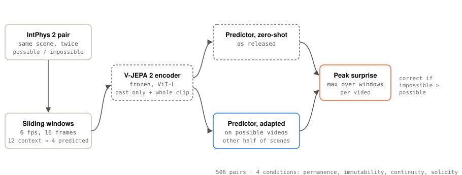
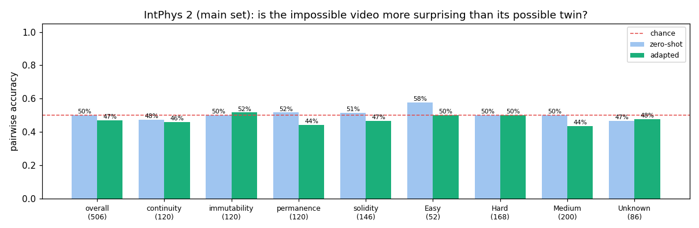
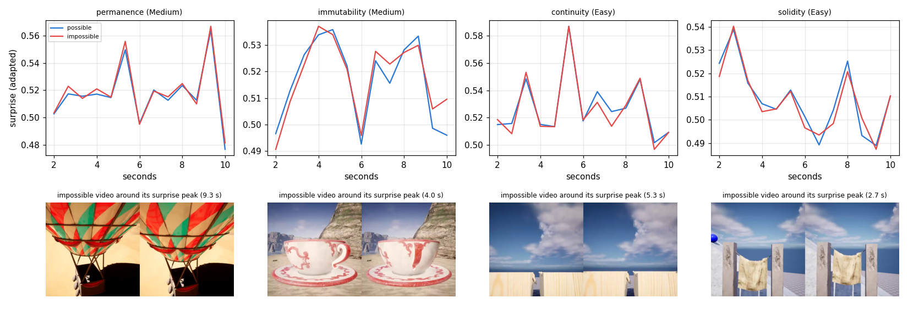
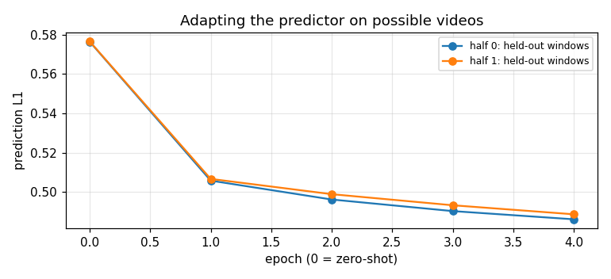

# 08 · V-JEPA 2 on IntPhys 2

[](https://colab.research.google.com/github/nunenuh/jepa-playground/blob/main/08_intphys2/intphys2.ipynb)

In [07](../07_physical_anomalies/), V-JEPA 2's surprise caught physically
impossible motion that we made by editing walkway video, once its predictor
was adapted to the camera. Does that hold on a real intuitive-physics
benchmark? **[IntPhys 2](https://huggingface.co/datasets/facebook/IntPhys2)**
(Meta, 2025) shows matched pairs of rendered videos, identical except that in
one of them physics breaks.

**Short answer: no.** Zero-shot and adapted, V-JEPA 2 (ViT-L) is at chance.

## Architecture

<picture>
  <source media="(prefers-color-scheme: dark)" srcset="assets/architecture-dark.svg">
  
</picture>

## Data

IntPhys 2 main set (CC BY-NC 4.0, evaluation use only), pinned to revision
`a077a2f`: 253 scenes, 1,012 videos, 506 matched pairs.

| Condition | What breaks in the impossible video | Pairs |
|---|---|---|
| permanence | an object vanishes or appears from nothing | 120 |
| immutability | an object changes shape or colour | 120 |
| continuity | an object teleports instead of moving through space | 120 |
| solidity | an object passes through another solid object | 146 |

Scenes range from simple coloured shapes (Easy) to realistic objects in
complex environments (Hard), with fixed or moving cameras.

## Setup

| Part | What it is |
|---|---|
| Model | `facebook/vjepa2-vitl-fpc64-256` (ViT-L encoder frozen) + its predictor |
| Video | every 10th frame (6 fps, as in the official evaluation), 256 × 256 |
| Windows | 16 frames: predict the last 4 from the first 12; stride 4 frames |
| Surprise | mean L1 error of the predicted latents; a video's score = its **peak** over time |
| Adapted | predictor fine-tuned on the **possible** videos of the other half of the scenes (two halves, swapped), 4 epochs; no scene is scored by a predictor that saw it, no impossible video is used for training |
| Metric | **pairwise accuracy**: is the impossible video's peak higher than its possible twin's? (50% = chance) |

Colab T4: ~14 min adapting, ~62 min scoring all 1,012 videos.

## Results



| Pairwise accuracy | Zero-shot | Adapted | Pairs |
|---|---|---|---|
| **Overall** | **50.2%** | **47.0%** | 506 |
| permanence | 51.7% | 44.2% | 120 |
| immutability | 50.0% | 51.7% | 120 |
| continuity | 47.5% | 45.8% | 120 |
| solidity | 51.4% | 46.6% | 146 |
| Easy | 57.7% | 50.0% | 52 |
| Medium | 50.0% | 43.5% | 200 |
| Hard | 50.0% | 50.0% | 168 |
| fixed camera | 53.4% | 46.6% | 208 |
| moving camera | 48.0% | 47.3% | 298 |

For scale, the IntPhys 2 paper reports V-JEPA 2 **ViT-huge** at 57.5% overall
(Easy 54.0, Medium 58.5, Hard 59.4), best run over a set of hyperparameters,
with its own protocol; humans get ~96%. Our ViT-L numbers use one fixed
setting, so they are not a like-for-like comparison. With 506 pairs, a
difference of about ±4 points from 50% is within noise.

Raw numbers: [`assets/results.json`](assets/results.json); every video's
peak surprise: [`assets/video_scores.csv`](assets/video_scores.csv).

### What the surprise curves look like



One pair per condition (pairs the adapted model got right). The possible
(blue) and impossible (red) curves **almost overlap**: the peaks are moments
both videos share (most likely camera motion or scene changes), while the
physics break involves one object and moves the curve only slightly.

### Adapting the predictor



Fine-tuning on possible videos cuts held-out prediction error by 16%
(0.577 → 0.486), but accuracy doesn't follow: 50.2% → 47.0%.

## What it shows

- **On IntPhys 2, V-JEPA 2's surprise is at chance**, zero-shot or adapted.
  That matches the benchmark paper's conclusion ("most models near chance"),
  now reproduced independently with a smaller model.
- **Why 07 worked and this doesn't.** In 07 the break hit the whole scene
  (everyone teleports, everything freezes) on one fixed camera, and the
  predictor was adapted to that exact camera. Here the break is one object in
  a large, varied, often moving scene: whole-frame surprise is dominated by
  what both videos share, and a predictor adapted on hundreds of different
  scenes doesn't learn any one scene's "normal".
- **Better prediction ≠ better physics judgement.** As in 06, the adapted
  predictor predicts the videos better and detects the violations no
  better. Lower prediction error means the model got better at *average*
  video, not at the rare object event that matters.
- **Caveats.** One model size (ViT-L), one window setting (12 → 4 frames at
  6 fps, peak over time), no hyperparameter search. The paper's best runs use
  ViT-huge, longer contexts and several settings.

## Experiments to try

| Change | What you'll see |
|---|---|
| Score only the top-k most surprising patches instead of the frame mean | Whether a one-object break stops being washed out |
| Longer context (24–42 frames, as in the paper's config) | Whether more history helps the predictor know what to expect |
| `facebook/vjepa2-vith-fpc64-256` (ViT-huge) | How much model size matters here |
| Only fixed-camera scenes | Whether camera motion is what hides the signal |

## Run

Click the Colab badge above, pick a GPU runtime, then Run all (about 80
minutes on a T4, plus a ~1.5 GB download). Or locally (needs a GPU with
~12 GB):

```bash
uv run --with torch --with transformers --with opencv-python --with pandas \
    --with matplotlib --with huggingface_hub python 08_intphys2/intphys2.py
```
