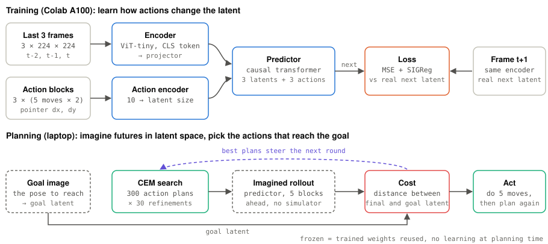
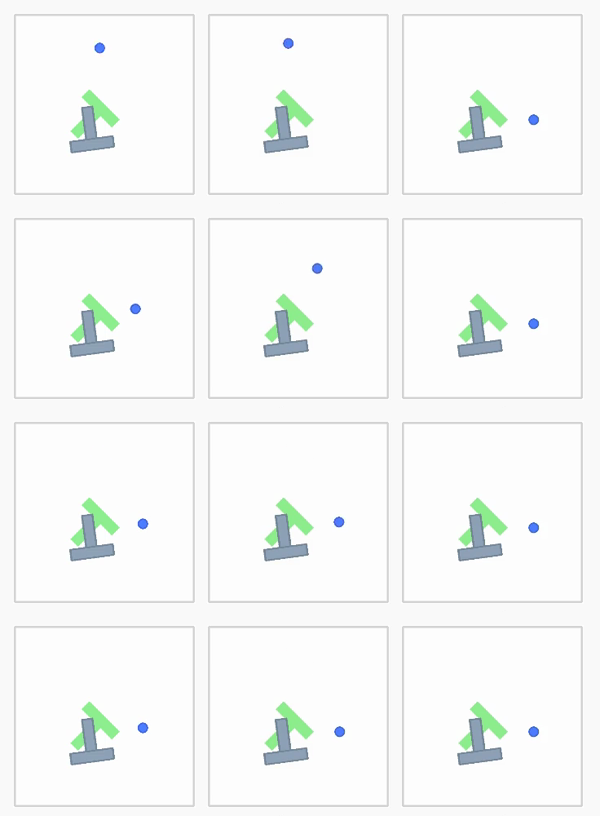
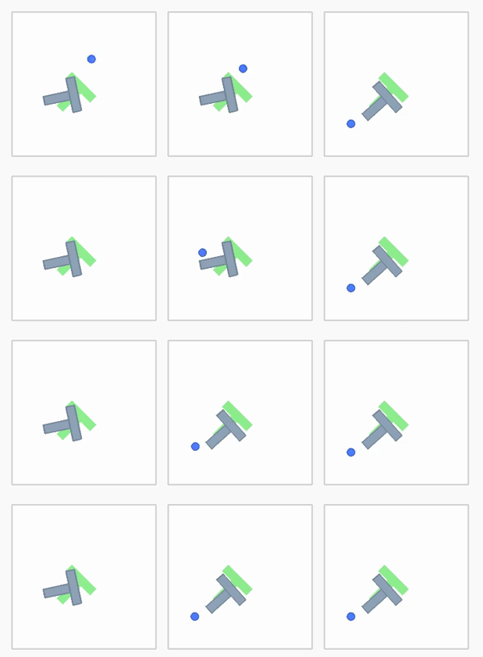
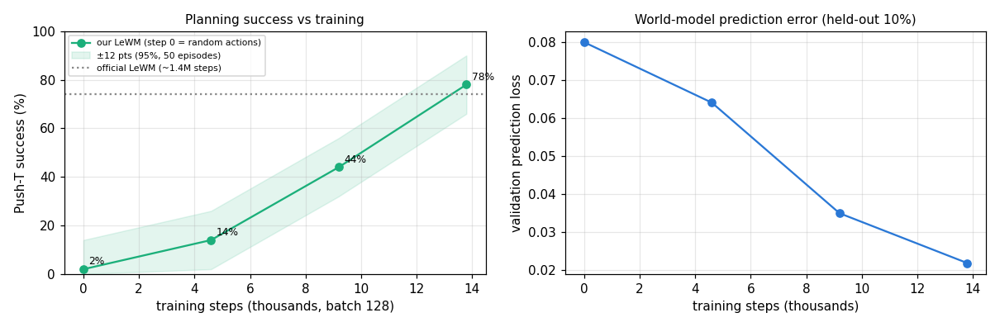
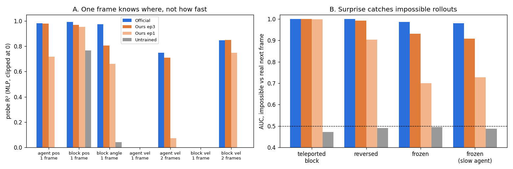
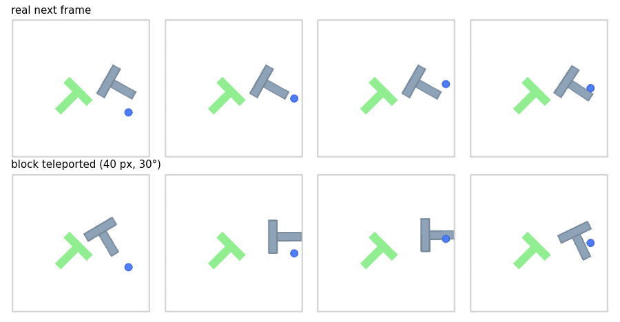
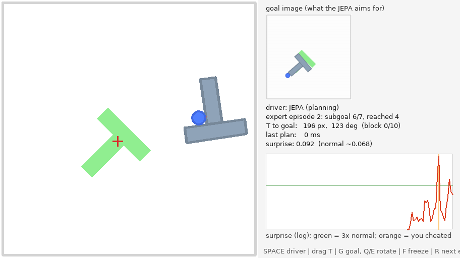
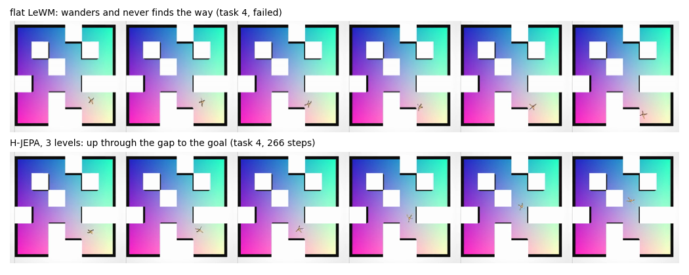

# 09 · A JEPA world model that plans (LeWorldModel)

[](https://colab.research.google.com/github/nunenuh/jepa-playground/blob/main/09_world_model/train_colab.ipynb) (training only; planning runs in Docker on a laptop GPU)

Experiments 01–08 only *watched*: they predicted what comes next. A world
model that **plans** also acts. Given the current camera image and a goal
image, it imagines in latent space what each candidate action sequence would
do, and executes the one that ends closest to the goal. No reward, no
reinforcement learning.

In short:
- **It plans:** 74% success in Push-T with the official checkpoint, **78% with
  our own** trained 3.5 h on Colab (~1% of the official budget). Doing
  nothing: 0%; random: 0–2%; replaying the expert's actions: 100%.
- **What the latent knows:** positions yes, velocity no (from one frame);
  the 3-frame predictor still catches frozen, reversed and teleported motion
  (AUC 0.93–1.00).
- **Play with it live** in a window ([`play.sh`](play.sh)): teleport the T,
  freeze the world, watch the surprise.
- **Its wall is long tasks** (2 of 21 whole episodes finished), and
  **hierarchy fixes much of it**: H-JEPA in Visual AntMaze, 20% flat → 80%
  with 3 levels.

## Architecture

<picture>
  <source media="(prefers-color-scheme: dark)" srcset="assets/architecture-dark.svg">
  
</picture>

Training: the encoder turns each frame into one latent, the predictor learns
which latent comes next given the actions, SIGReg (from
[02](../02_collapse/)) keeps the latents from collapsing. Planning: CEM tries
300 action plans, rolls each out 5 blocks ahead with the predictor only (no
simulator), scores it by the distance to the goal's latent, keeps the best 30
and resamples around them, 30 rounds; then it does the first 5 moves and
plans again.

## Setup

| Part | What it is |
|---|---|
| Model | [LeWorldModel](https://github.com/lucas-maes/le-wm) (LeCun, Balestriero et al., 2026), ~15M parameters: ViT-tiny encoder + transformer predictor, SIGReg; official checkpoint [`quentinll/lewm-pusht`](https://huggingface.co/quentinll/lewm-pusht) |
| Task | Push-T: push the grey T to a goal pose with the blue pointer; start mid-episode, goal 25 steps later, 50 steps allowed (LeWM's evaluation) |
| Our training | LeWM's Push-T expert data (18,685 episodes), 3 epochs / 13,791 steps, Colab A100, ~3.5 h |
| Planner | CEM: 300 samples, top 30, 30 iterations, horizon 5 blocks of 5 moves, replan every 5 moves |
| Evaluation | 50 episodes, same starts for every policy; Push-T normalisers from the 21 H-JEPA validation episodes |
| Part 5 | [H-JEPA](https://huggingface.co/papers/2610.06805) released checkpoints in Visual AntMaze, first 10 of their 50 tasks, seed 42 |
| Hardware | Training: Colab A100. Everything else: Docker on an RTX A2000 laptop (4 GB) |

## Results

### Part 1: planning in Push-T on a laptop

**Push-T**: push the grey T so it matches a goal pose, using the blue pointer.
Following LeWM's evaluation settings: start from a state of an expert
episode, the goal is the state **25 steps later**, the planner gets **50
steps**. 50 episodes, same starts for every policy.

| Policy | Success | Time (50 episodes) |
|---|---|---|
| Stand still (zero actions) | **0%** | 18 s |
| Random actions | **0–2%** | 21–35 s |
| **LeWM + CEM planning** | **74%** | 189–201 s |
| Replay the expert's 25 recorded actions (open loop) | **100%** | 10 s |

(Two runs; the planner samples, so success moves by a few points between
runs: random 0% then 2%, our epoch-2 model below 48% then 44%.)

The two baselines bound the task. Standing still never succeeds, so no goal
is already reached at the start. Replaying the demonstration always succeeds:
the simulator is deterministic, so the expert's own actions are a perfect
answer. That replay is a cheat, though: it needs the exact actions, while the
planner gets only the goal image and has to find its own. The planner closes
74% of the gap between doing nothing and the perfect answer.

RTX A2000 Laptop GPU (4 GB), ~15 MB of GPU memory. Raw numbers:
[`assets/results.json`](assets/results.json).

A successful episode (left: the agent; middle: what the expert did; right:
the goal), every 12th frame top to bottom:



A failed one:



Notes:

- The action and state normalisers are fit on the 21 Push-T validation
  episodes released with [H-JEPA](https://huggingface.co/datasets/jepa-world-models/h-jepa)
  (16 MB), not on LeWM's 13 GB training set; this is the main difference
  from the official evaluation, and may cost some success.
- The LeWM paper reports Push-T only as a figure (18% above PLDM), so there's
  no exact number to compare with yet.


### Part 2: training our own on Colab, planning on the laptop

Same model and recipe as the official checkpoint
([`train_colab.ipynb`](train_colab.ipynb), stable-worldmodel's
`scripts/train/lewm.py`): LeWM's Push-T expert data (18,685 episodes,
13 GB download, 46 GB unpacked), ViT-tiny encoder, SIGReg weight 0.09, batch
128. Only the budget differs: **3 short epochs, 13,791 steps** (the official
run is 100 epochs × 13,933 steps, ~100× more). Colab A100, ~3.5 h.



| Model | Training steps | Push-T success (same 50 episodes) |
|---|---|---|
| Random actions | 0 | 2% |
| Ours, epoch 1 | 4,597 | 14% |
| Ours, epoch 2 | 9,194 | 44% |
| **Ours, epoch 3** | **13,791** | **78%** |
| Official LeWM | ~1.4M | 74% |

- **A JEPA world model learns to plan fast.** Success climbs 14% → 44% →
  78% while the held-out prediction error falls 0.080 → 0.022; with ~1% of
  the official budget it matches the official checkpoint (78% vs 74% is
  within the ±12-point noise of 50 episodes).
- **Better prediction → better planning, here.** Unlike 06 (where a better
  predictor didn't detect anomalies better), in Push-T planning lower
  prediction error turned straight into more successes: the planner *uses*
  the predictions, so their quality is what matters.
- **The bottleneck is data, not the GPU.** Training ran at 1.5 steps/s
  because each sample decompresses a block of frames from the HDF5 file; the
  GPU sat mostly idle. Loading the file into RAM first (`cat > /dev/null`)
  and 11 loader workers were enough to make it practical on Colab.
- **Caveat.** One training run (seed 3072), 50 evaluation episodes; the
  official checkpoint may still be stronger on harder settings (longer
  goals, other environments).

Raw numbers: [`assets/results.json`](assets/results.json) (planning),
[`assets/training.json`](assets/training.json) (training).

### Part 3: what does the latent know? Velocity and impossible rollouts

[`probe.py`](probe.py), laptop GPU, ~10 min. Two questions:

**A. Velocity check** ([Velocity Blind Spot](https://huggingface.co/papers/2610.04585)).
Probes from the latent to positions and velocities. Data: 10,000 random
simulator states, each rendered twice 0.5 s apart (one action block), moved
by velocities drawn from the expert episodes; 8,000 to fit, 2,000 to test.
(Probes fit on the 21 validation episodes overfit: 15 episodes are too few.)

**B. Impossible rollouts.** The predictor sees 3 real frames and the actions,
and predicts the next latent; surprise = squared error to what came next.
Real next frames vs impossible ones: **frozen** (nothing moved), **reversed**
(the previous frame), **teleported** block (re-rendered in the simulator,
moved and turned). 440 clips from the validation episodes.



| R² (MLP probe; 1 = perfect, 0 = nothing) | Official | Ours ep3 | Ours ep1 | Untrained |
|---|---|---|---|---|
| Agent position, 1 frame | 0.98 | 0.98 | 0.72 | ~0 |
| Block position, 1 frame | 0.99 | 0.97 | 0.95 | 0.77 |
| Block angle, 1 frame | 0.97 | 0.81 | 0.66 | 0.04 |
| **Agent velocity, 1 frame** | **~0** | **~0** | **~0** | ~0 |
| **Block velocity, 1 frame** | **~0** | **~0** | **~0** | ~0 |
| Agent velocity, 2 frames | 0.75 | 0.71 | 0.07 | ~0 |
| Block velocity, 2 frames | 0.85 | 0.85 | 0.75 | ~0 |

| Surprise AUC (impossible vs real) | Official | Ours ep3 | Ours ep1 | Untrained |
|---|---|---|---|---|
| Teleported block | 1.00 | 1.00 | 1.00 | 0.47 |
| Reversed | 1.00 | 0.99 | 0.90 | 0.49 |
| Frozen | 0.99 | 0.93 | 0.70 | 0.50 |
| Frozen, slow agent only | 0.98 | 0.91 | 0.73 | 0.49 |



- **One frame knows *where*, not *how fast*.** Positions and angle are read
  almost perfectly, velocity not at all (R² ≈ 0): the Velocity Blind Spot,
  confirmed. No surprise: one picture can't show motion.
- **The predictor fixes it with history.** Two latents give velocity back
  (R² 0.71–0.85), and LeWM's predictor sees 3 frames, so it catches frozen and
  reversed motion (AUC 0.93–1.00), even when the agent moves slowly. That's
  what V-JEPA 2 missed in [07](../07_physical_anomalies/). The TI-JEPA fix
  (a separate motion code) isn't needed for Push-T.
- **Big jumps are easy, small ones need training.** Even the 1-epoch model
  catches a teleport; "frozen" is what separates 1 epoch (0.70) from 3 (0.93)
  and the official model (0.99).
- **Our weak spot: the block angle** (0.81 vs 0.97). A plausible reason the
  official checkpoint will be more reliable on harder goals.
- **Check the control.** An untrained encoder already reads block position
  (0.77): the grey block is a big patch of pixels. The gain from training is
  in agent position, angle and velocity.

Raw numbers: [`assets/results_probe.json`](assets/results_probe.json). The
re-rendered frames match the dataset's pixels (mean difference 0.3/255).

### Part 4: play with it (live window)

[`live.py`](live.py) / [`play.sh`](play.sh): Push-T in a window on your
desktop. The JEPA plans and pushes; you can interfere and watch its surprise.

```bash
./09_world_model/play.sh                         # our model, starting at validation episode 2
./09_world_model/play.sh --model quentinll/lewm-pusht --episode 11
```

| Key / mouse | What happens |
|---|---|
| (nothing) | The JEPA follows an expert episode as a chain of subgoals, each 25 steps ahead (the goal image, top right) |
| drag the T | Teleport it: impossible, so surprise spikes (orange line on the graph); the JEPA replans |
| F | Freeze the world for one block: the pointer "moves" but nothing happens, surprise spikes |
| SPACE | You drive: the pointer follows your mouse; the JEPA still predicts and shows surprise |
| G, Q / E | Your own goal at the mouse, turned with Q / E (experimental, see below) |
| R / ESC | Next episode / quit |



(Screenshot from the test mode: the T was teleported at the orange line.)

What it shows, measured with `live.py --eval-episodes 21`:

- **The planner matches the official evaluation.** Our CEM, on LeWM's own
  task (start mid-episode, goal 25 steps ahead, 50 steps): 21/30 = 70% (eval:
  78%). Replanning after every 2 blocks instead of 5 drops it to 43%: the plan
  always aims to arrive at the last step, so replanning early keeps pushing
  the arrival back.
- **Long tasks are the wall.** Following whole expert episodes as subgoal
  chains, it reaches 28 of 109 subgoals (26%) and finishes 2 of 21 episodes
  (2 and 11). One miss makes the next subgoal farther, and failures cascade.
- **Your own goals mostly fail** (1 of 20 goals 40 px / 20° away, even with the
  goal latent averaged over 16 pointer positions so the planner aims for the
  T, not the pointer): from a random start the pointer first has to walk
  around the T, which is beyond a 25-step plan. This is the long-horizon
  blocker in [RESEARCH_LANDSCAPE](../RESEARCH_LANDSCAPE.md) (hierarchical
  planning, H-JEPA, is the proposed fix).
- **Surprise works live.** Normal steps sit around 0.01–0.03; a teleport jumps
  to ~0.3 (10–20×).

Needs an X11 desktop. `play.sh` lets the container's root user draw on your
display (`xhost +SI:localuser:root`) and takes it back on exit.

### Part 5: hierarchy fixes the long-horizon wall (H-JEPA in Visual AntMaze)

Parts 2–4 hit the same wall: LeWM plans ~25 steps ahead, so longer tasks
fail. [H-JEPA](https://huggingface.co/papers/2610.06805) (Zhang, Terver,
Rabbat, LeCun, Balestriero, Oct 2026) stacks LeWMs in levels, each predicting
farther ahead, and plans top-down: the top level picks waypoints, the bottom
level walks. Their paper shows little gain on Push-T (40% → 45%) but a big one
in navigation, so we tested it there.

**Visual AntMaze**: a 3D four-legged ant robot must walk to a goal 3 maze
cells away, seeing only a 64×64 camera image and a goal image, within 350
steps. Their released checkpoints (seed 42) and their evaluation (same fixed
tasks, planner settings), first 10 of their 50 tasks, on the laptop GPU
([`hjepa/`](hjepa/): Dockerfile + [`antmaze.py`](hjepa/antmaze.py), ~5 min per task).

| Planner | Reached (10 tasks) | Paper (50 tasks) | Time for 10 tasks |
|---|---|---|---|
| Flat LeWM | **2 (20%)** | 18% | 39 min |
| H-JEPA, 2 levels | **6 (60%)** | 39% | 22 min |
| H-JEPA, 3 levels | **8 (80%)** | 73% | 26 min |



Side-by-side video: [`assets/antmaze_task04_side_by_side.mp4`](assets/antmaze_task04_side_by_side.mp4).

- **Hierarchy works.** 20% → 60% → 80% with more levels, reproducing the
  paper's trend (18 → 39 → 73%); flat LeWM matches the paper almost exactly.
  With 10 tasks the error bars are about ±15 points, so 60% vs the paper's 39%
  for 2 levels is within noise.
- **What it looks like:** when the goal is behind a wall, the flat ant heads
  straight for it and gets lost; the hierarchical ant first goes through the
  gap the top level chose as a waypoint.
- **It's also faster:** fewer failed tasks run to the 350-step limit, and the
  upper levels search a short, coarse plan instead of a long fine one.
- **Still not solved:** 2 of 10 tasks fail even with 3 levels, and the
  remaining long-horizon pieces (memory, own goals, speed) are what the
  game-agent spin-off in the [ROADMAP](../ROADMAP.md) is about.

Raw numbers: [`assets/results_antmaze.json`](assets/results_antmaze.json).

## What it shows

- **A JEPA world model plans without rewards.** It only learned to predict
  latents, yet searching over its imagined futures pushes the T to the goal
  in 3 of 4 episodes.
- **Better prediction, better planning.** Unlike 06, here lower prediction
  error turned straight into more successes (14% → 44% → 78% over 3 epochs):
  the planner uses the predictions directly.
- **Training is cheap; data loading is the bottleneck.** ~1% of the official
  budget matched the official checkpoint; the GPU mostly waited for the HDF5
  frames.
- **One latent is a snapshot.** It has positions but no velocity; motion
  comes from the predictor's 3-frame history, which is enough to catch
  impossible motion that V-JEPA 2 missed in 07.
- **What failed:** long tasks (whole episodes 2/21, your own goals 1/20),
  because one plan only looks ~25 steps ahead. Replanning more often made it
  worse (43%). Our model reads the block angle worse than the official one
  (0.81 vs 0.97).
- **Hierarchy is the fix that worked:** stacking world models that look
  farther ahead took AntMaze from 20% to 80%, though 2 of 10 tasks still fail.

## Experiments to try

- Train one more epoch (or with a larger batch) and see if the block-angle
  probe and the "frozen" AUC catch up with the official model.
- Change the planner: `num_samples` 300 → 100 (faster, how much worse?), or
  horizon 5 → 3 blocks.
- Goals 50 steps ahead instead of 25: where does flat planning break down?
- `play.sh`: teleport the T near the goal vs far from it and watch whether
  the replan recovers.
- H-JEPA on Push-T (the paper's 40% → 45%) to see the hierarchy's gain where
  tasks are short.

## Run it on your laptop (Docker)

Needs Docker with the NVIDIA runtime (`nvidia-container-toolkit`) and an
NVIDIA driver ≥ 560. Inference only; nothing is trained.

```bash
docker build -t jepa-wm 09_world_model            # ~15 GB image (PyTorch + simulators)
docker run --rm --gpus all \
    -v jepa-wm-data:/data \
    -v "$PWD/09_world_model/assets:/out" \
    jepa-wm --episodes 50                          # results.json + one mp4 per episode
```

- `--policies quentinll/lewm-pusht random`: Hugging Face repo ids, checkpoint
  folders under `$STABLEWM_HOME/checkpoints` (a `config.json` + one `.pt`,
  e.g. our Colab-trained model copied into the `jepa-wm-data` volume), or
  `random`.
- Simulators render off-screen (pygame / EGL), so no display is needed; the
  videos land in `09_world_model/assets/videos/`.
- Other parts: `probe.py` (Part 3) and `live.py` (Part 4) run in the same
  image (commands at the top of each file, or `./09_world_model/play.sh`);
  Part 5 has its own image: `docker build -t hjepa 09_world_model/hjepa`,
  then the command at the top of [`hjepa/antmaze.py`](hjepa/antmaze.py).
- Training: [`train_colab.ipynb`](train_colab.ipynb) on a Colab A100.
- Pins, so it keeps working: `stable-worldmodel` at a fixed commit, PyTorch
  2.7.1 built for CUDA 12.6 (works with driver 560), `transformers < 5`
  (the released checkpoints use the 4.x ViT parameter names).
